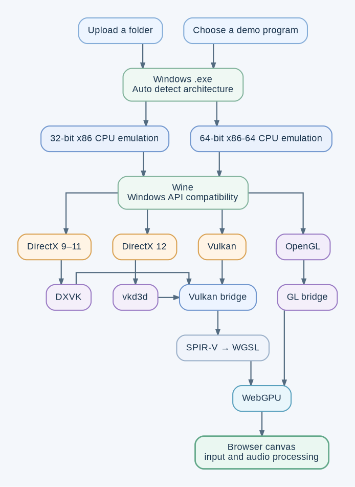

# [Winbox](https://kn0tzer.work.gd/winbox)

Windows apps and games in a browser:
- 32-bit and 64-bit CPU emulation in Web Assembly
- Wine
- OpenGL, Vulkan, and Directx 9-12 all converted to WebGPU

## Program support
- Chromium
- Notepad
- Celeste
- DOOM
- Portal
- File explorer
- Snake

## How it was made
Codex 6.1 sol in a loop for around 2 weeks. Everything the user interacts with (including this readme) is made by me. The entire backend is complete slop. Based on [Boxedwine64](https://github.com/andrewnakas/Boxedwine64) which is based on [Boxedwine](https://github.com/danoon2/Boxedwine) which is based on [Wine](https://github.com/wine-mirror/wine)

## How it works

